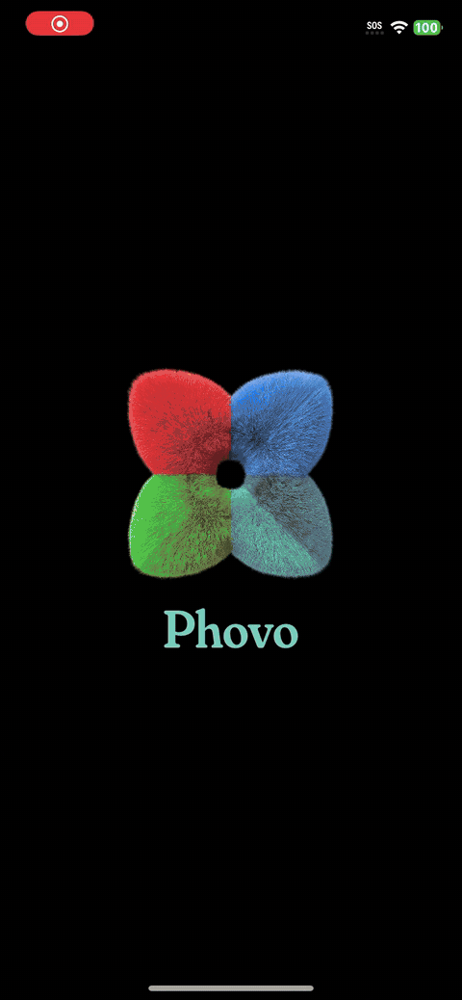
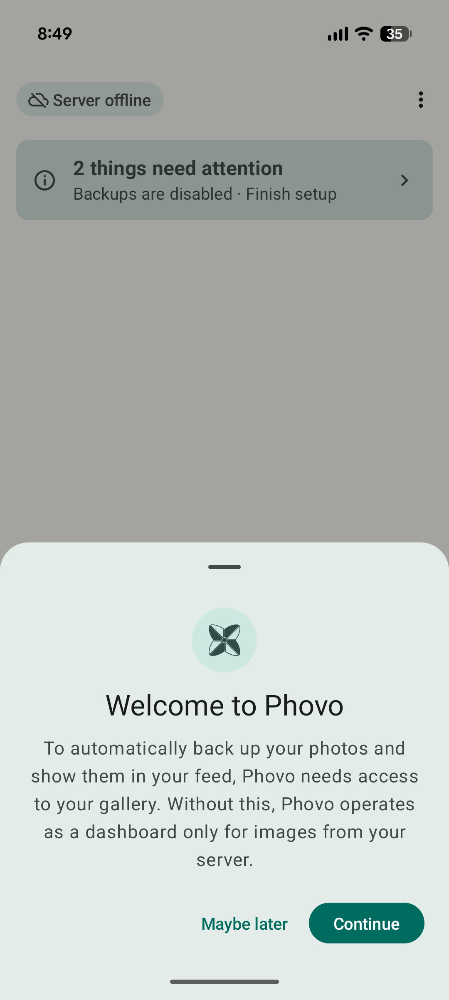
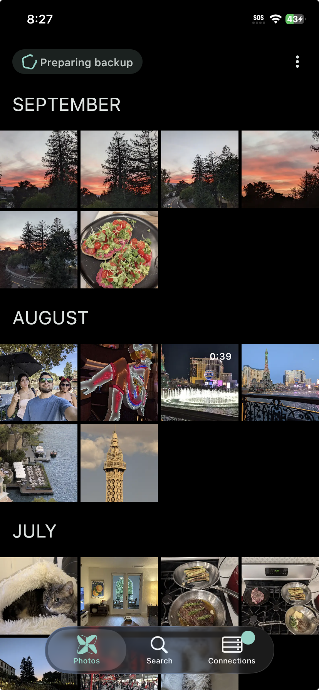
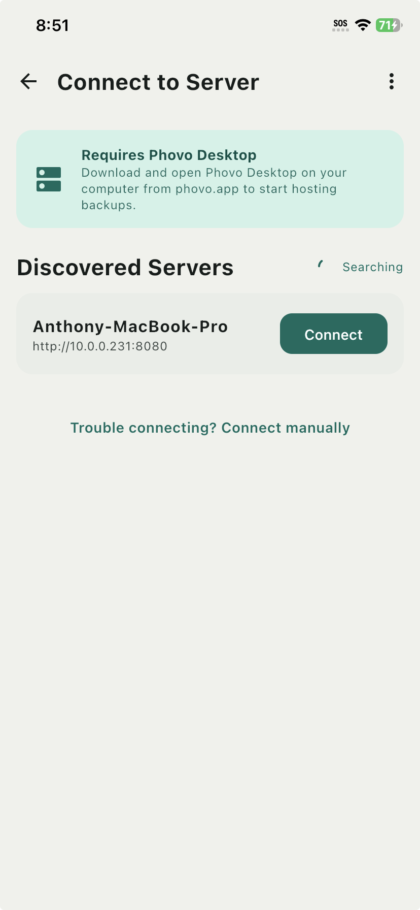
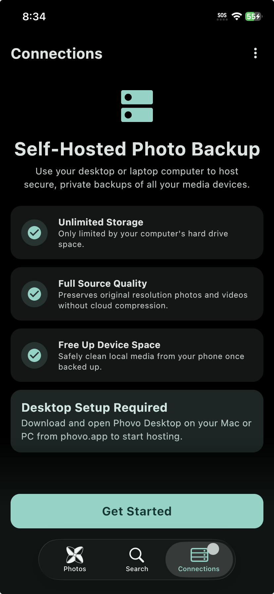
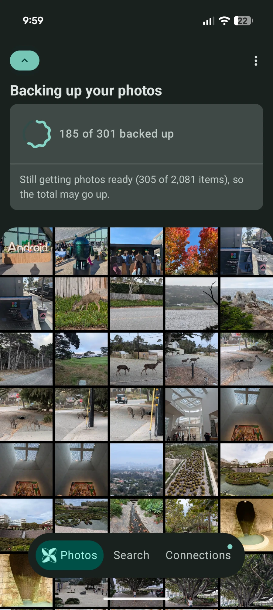
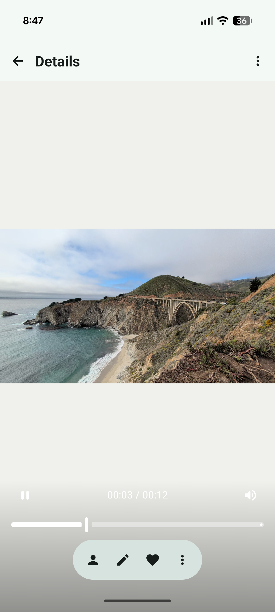
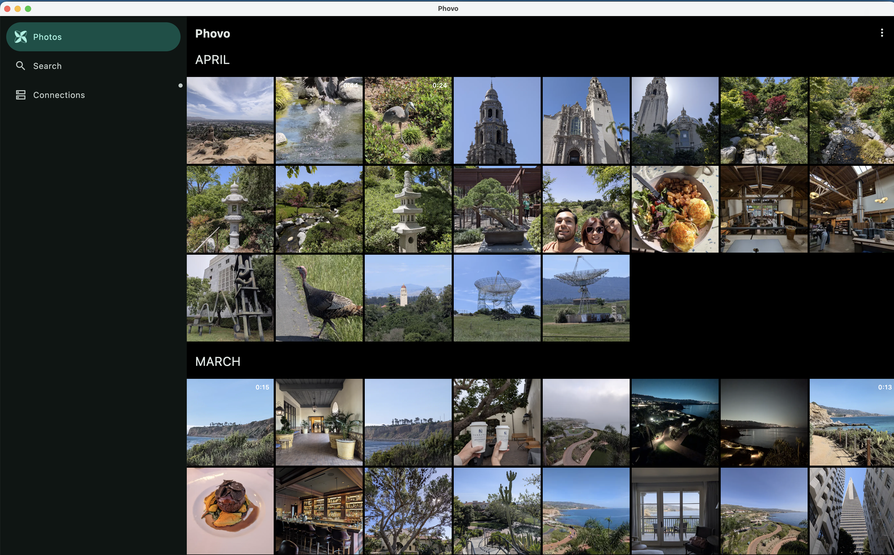

<p align="center">
  <picture>
    <source media="(prefers-color-scheme: dark)" srcset="docs/images/phovo_readme_banner_dark.png">
    
  </picture>
</p>

<h3 align="center">Your photos and videos, backed up to a computer you own.</h3>

<p align="center">
  Phovo turns the desktop or laptop you already have into a private photo cloud.<br>
  Your phone backs up to it over Wi-Fi, at full quality, with no subscription.
</p>

<p align="center">
  <a href="https://phovo.app"><b>phovo.app</b></a>
  &nbsp;·&nbsp;
  <a href="#downloads"><b>Downloads</b></a>
  &nbsp;·&nbsp;
  <a href="#roadmap"><b>Roadmap</b></a>
</p>

<p align="center">
  <a href="https://github.com/Anthony17serrato/Phovo/releases"></a>
  
  
</p>

<p align="center">
  
</p>

<table align="center">
  <tr>
    <th align="left" width="280">📱&nbsp; Using Phovo</th>
    <th align="left" width="280">🛠️&nbsp; Working on Phovo</th>
  </tr>
  <tr>
    <td valign="top">
      <a href="#why-phovo">Why Phovo</a><br>
      <a href="#how-it-works">How it works</a><br>
      <a href="#screenshots">Screenshots</a><br>
      <a href="#downloads">Downloads</a><br>
      <a href="#roadmap">Roadmap</a>
    </td>
    <td valign="top">
      <a href="#technical-details">Technical details</a><br>
      <a href="#build-and-run">Build and run</a><br>
      <a href="#source-sets">Source sets</a><br>
      <a href="#troubleshooting-wasm">Troubleshooting WASM</a><br>
      <a href="#branching-and-releases">Branching and Releases</a>
    </td>
  </tr>
</table>

<br>

## Why Phovo

Cloud photo storage charges you every month for space on someone else's servers, and the bill grows with your library. Phovo keeps your library on your own computer. The phone app uploads new photos and videos to it automatically, and Phovo Desktop shows the whole library as one timeline.

- **Storage that grows with your drive.** Phovo has no quota or storage plan. Plug in a bigger disk when you need more room.
- **Originals, untouched.** Photos and videos are stored at their original resolution, with no cloud compression.
- **Private by design.** Your media travels from your phone to your computer over your own network, and no company in between sees it.
- **Finds your computer for you.** Open the app on the same Wi-Fi as Phovo Desktop and it discovers the server on its own. You can type an address in instead if your network blocks discovery.
- **Backs up in the background.** Uploads carry on after you switch to another app.
- **One app on every device.** Android, iPhone, macOS, Windows and Linux all run the same Phovo, down to a Raspberry Pi.

## How it works

1. **Install Phovo Desktop** on the computer that will hold your library. It hosts the backup server.
2. **Open Phovo on your phone** and allow access to your photo library.
3. **Connect.** Phovo lists the servers it finds on your network. Tap yours and your library starts uploading.

## Screenshots

<p align="center">
  
  
  
</p>
<p align="center">
  
  
  
</p>

<p align="center"><b>Phovo Desktop</b></p>
<p align="center">
  
</p>

## Downloads

Phovo is in alpha. Expect bugs, and expect breaking changes between releases until the beta.

Builds are published on [GitHub Releases](https://github.com/Anthony17serrato/Phovo/releases). Each
release has one file per system, named `Phovo-<version>-<os>-<arch>.<ext>`:

| System | File |
|---|---|
| macOS, Apple Silicon (M1 and later) | `…-macos-arm64.dmg` |
| macOS, Intel | `…-macos-x64.dmg` |
| Windows 10/11 (also Windows on ARM, through emulation) | `…-windows-x64.msi` |
| Ubuntu, Debian, Linux Mint, Pop!_OS | `…-linux-x64.deb` |
| Fedora, RHEL, Rocky, AlmaLinux, openSUSE | `…-linux-x64.rpm` |
| Arch, Manjaro and other distros | `…-linux-x64.tar.gz` |
| Raspberry Pi 3, 4, 5 or Zero 2 W on 64-bit Raspberry Pi OS | `…-linux-arm64.deb` (or `…-linux-arm64.tar.gz`) |
| Android | `…-android.apk` |

The iPhone app isn't available to download yet.

The `.tar.gz` needs no installing: unpack it anywhere and run `Phovo/bin/Phovo`. It doesn't add a menu
entry. The Raspberry Pi builds need the 64-bit edition of Raspberry Pi OS; 32-bit
systems can't run them.

The desktop builds aren't code signed yet (tracked in [#214](https://github.com/Anthony17serrato/Phovo/issues/214)), so the first launch shows a warning:

- **macOS:** **"Phovo" Not Opened** ("Apple could not verify "Phovo" is free of malware…"). Click
  **Done**, not Move to Trash. Then open **System Settings → Privacy & Security**, scroll down to
  Security, click **Open Anyway** next to the Phovo message, confirm with your password or Touch ID, and
  click **Open**. This is needed once per version.
- **Windows:** "Windows protected your PC". Click **More info**, then **Run anyway**.

Every release's notes start with these steps too, from
[`.github/release-notes-header.md`](.github/release-notes-header.md).

## Roadmap

| Milestone | Date | Who can use it | What to expect |
| --- | --- | --- | --- |
| **Alpha** | October 31, 2026 | Early testers | Core features under test. Bugs, instability and breaking changes with no backward compatibility. |
| **Beta** | February 28, 2027 | Public | Initial features complete and no more breaking changes. Work shifts to stability and remaining bugs. |
| **Stable** | May 31, 2027 | Android, iOS and desktop | Production ready, with all critical and high-priority bugs fixed. |

Wear OS, Android XR and Android TV apps may follow if there's demand for them.

<br>

---

## Technical details

Everything below is for people working on Phovo itself.

Every Phovo app comes from one codebase. [Kotlin Multiplatform](https://kotlinlang.org/docs/multiplatform.html) shares the logic across Android, iOS, desktop and web (WASM), and the UI is written once in [Compose Multiplatform](https://www.jetbrains.com/lp/compose-multiplatform/).

### Build and run

Set up your machine for Kotlin Multiplatform development first, following the [official guide](https://kotlinlang.org/docs/multiplatform/quickstart.html#set-up-the-environment).

The desktop build embeds an FFmpeg binary, used for thumbnail generation. It is downloaded and
verified against a pinned SHA-256 on the first build, so that build needs network access. The
archive is cached under `~/.gradle/caches/phovo-ffmpeg`, which survives `clean`, so later builds
work offline. Only the binary for the platform running the build is fetched. The pinned builds, and
notes on updating them, live in `build-logic`'s `FfmpegDistribution.kt`.

#### Windows: x64 only
Phovo publishes Windows builds for x64 only. Windows on ARM devices run the x64 build through
Windows' built-in x64 emulation, so there is no separate ARM64 release.

The reason is SQLite. Room uses `BundledSQLiteDriver` from `androidx.sqlite:sqlite-bundled`, and its
JVM artifact ships a native library for `windows_x64` but none for `windows_arm64` (checked on 2.6.2
and 2.7.0). A native ARM64 build compiles and launches, but every database call then fails with
`Cannot find a suitable SQLite binary for windows 11 | aarch64`.

##### Building the x64 release on a Windows on ARM machine
The packaged app bundles the JVM that runs Gradle, and the Skiko and FFmpeg binaries are picked by
that JVM's architecture. To get an x64 app on an ARM machine, Gradle has to run on an x64 JVM:

1. Set `JAVA_HOME` to an **x64 JetBrains Runtime 17**. `gradle/gradle-daemon-jvm.properties`
   requires a JetBrains 17 daemon, so with any other JDK Gradle falls back to an ARM64 JetBrains
   Runtime and the result is ARM64 again.
2. Stop any running daemons so an ARM64 daemon is not reused.
3. Force `createRuntimeImage` to run. It does not notice an architecture change when the JDK
   version is the same, and would otherwise keep a stale ARM64 runtime next to an x64 launcher,
   which fails to start.

```
./gradlew --stop
./gradlew :applicationContainers:desktopApp:createRuntimeImage --rerun :applicationContainers:desktopApp:createDistributable --no-configuration-cache
```

The same `--rerun` applies when switching back to an ARM64 JVM on the same checkout, or run `clean`
first.

### Source sets

Some features only exist on some platforms, so the modules use custom source sets (for example `commonIosAndroid`) to share that code between just the platforms that need it. See [Declaring custom source sets](https://kotlinlang.org/docs/multiplatform/multiplatform-advanced-project-structure.html#declaring-custom-source-sets) in the Kotlin docs.

### Troubleshooting WASM

After adding a dependency, the WASM build may need its yarn lock upgraded:

```
./gradlew kotlinUpgradeYarnLock
```

### Branching and Releases

Releases are published on [GitHub Releases](https://github.com/Anthony17serrato/Phovo/releases). Alphas and
betas are marked as pre-releases, so the "Latest" badge always points at the newest stable build.

#### Branches

| Branch | Holds | Releases tagged from it |
|---|---|---|
| `main` | Stable code. It only changes through PRs from `develop`, `release/*` or `hotfix/*`. | Stable: `v1.0.0`, `v1.0.1`, `v1.1.0` |
| `develop` | The default branch. Feature and fix branches merge here. | Alphas, and betas before 1.0 |
| `release/x.y` | A beta line, cut from `develop` when version x.y stops taking new features. Deleted after it ships. | Betas: `v1.1.0-beta.1`, `v1.1.0-beta.2` |
| `hotfix/x.y.z` | A patch for the current stable version, cut from `main`. | None. The patch (e.g. `v1.0.1`) is tagged on `main` after the merge. |
| `feature/*`, `fix/*`, `docs/*` | Day to day work, merged into `develop` by PR. | None |

Before 1.0 there is nothing older to keep stable, so `develop` carries both the alphas and the betas and
no `release/*` branch exists. Once 1.0 ships, `develop` moves on to the next version and each later beta
gets its own `release/x.y` branch.

```
main        ──●───────────────●──────────●─────────▶  stable: v1.0.0, v1.0.1, v1.1.0 …
              ▲  hotfix/1.0.1 │          ▲
              │       ╲       ▼          │ (1.1 is done)
release/1.1   │        ●──────●────●─────●            beta: v1.1.0-beta.1, beta.2 …
              │       ╱            ╲ merge forward
develop     ──●──────●──────────────●──────────────▶  next features (1.2 alpha)
```

#### Release notes

GitHub writes each release's notes from the PRs merged since the previous release on the same line (see
"Releasing" below). A workflow labels every PR
from its branch name, and the label decides the PR's section:

| Branch | Label | Section |
|---|---|---|
| `feature/*` | `enhancement` | Features |
| `fix/*`, `hotfix/*` | `bug` | Fixes |
| `docs/*` | `documentation` | Documentation |
| `chore/*` | `chore` | Maintenance (library bumps, CI, build changes) |

PRs from `develop`, `main` or `release/*` (promotions and merge-forwards) get `skip-changelog`, since the
PRs they carry are already listed. Anything else lands under "Other changes". Add `skip-changelog` by hand
to keep any other PR out of the notes.

#### Releasing

[`release.yml`](.github/workflows/release.yml) builds every file on its own runner and creates a **draft**
release. Nothing is public until the draft is published by hand.

1. Open a PR into the branch the release comes from (`develop` for alphas and betas before 1.0,
   `release/x.y` for later betas, `main` for stable) that bumps `versionName` in `version.properties`.
2. Add the `release` label and merge it.
3. The workflow checks the version first. It stops if the tag already exists, if the version's stage
   doesn't fit the branch (stable only from `main`), or if the version isn't newer than a release it could
   be installed over. A stable version is compared with earlier stable releases, so a `1.0.1` hotfix can
   still ship after `1.1.0-beta.1`. A pre-release is compared with every release on its own `major.minor`
   line.
4. Five runners build the desktop files (macOS arm64 and x64, Windows x64, Linux x64 and arm64) and one
   builds the signed APK. A last job adds `SHA256SUMS` and creates the draft, tagged on the merged commit,
   with notes generated from the PRs since the previous release on the same line: the previous stable
   release for a stable version, or the previous release on its `major.minor` line for a pre-release.
5. Download and try the files, edit the notes, then click **Publish release**. The tag is created at this
   point.

**Run workflow** on the Actions tab starts it by hand. `test-only` builds every file without creating a
release, and the files are on the run's summary page. `draft` creates a draft from the chosen branch, which
is how a version already in `version.properties` gets released without a bump PR.

#### Patching stable and beta together

A fix goes on the oldest line that has the bug and is then merged forward into every newer line. Each
newer branch picks the fix up through an ordinary merge, which also leaves a record in history of which
lines have it.

1. Cut `hotfix/1.0.1` from `main` and fix the bug there.
2. Merge it into `main` and release `v1.0.1`.
3. Merge `main` into `release/1.1` and release the next beta, e.g. `v1.1.0-beta.3`.
4. Merge `release/1.1` into `develop`.

A bug that only exists in the beta gets its fix on `release/1.1`, which is then merged into `develop`.
Avoid fixing on `develop` and cherry-picking backwards: the copies aren't linked in history, so it's easy
to miss a line.

#### Versioning

Versions follow [SemVer](https://semver.org) with a pre-release suffix, and every release is a tag of the
form `v<version>`:

```
v1.0.0-alpha.1 → v1.0.0-alpha.2 → v1.0.0-beta.1 → v1.0.0 → v1.0.1 → v1.1.0-beta.1 → v1.1.0
```

Keep the dot before the pre-release number. SemVer compares `alpha.10` numerically, after `alpha.9`, but
compares `alpha10` as text, which puts it before `alpha9`.

Installers can't use that version directly. macOS and Windows packages only accept plain numbers, Android's
`versionCode` must be an integer, and all of them refuse to install a lower number over a higher one. The
numeric versions are calculated from the SemVer version so they sort the same way across every release
line:

```
versionCode = major × 1,000,000 + minor × 10,000 + patch × 100 + stage
stage:        alpha.N = 10 + N    beta.N = 50 + N    rc.N = 80 + N    stable = 99
```

| Version | Android `versionCode` | Desktop package version |
|---|---|---|
| `1.0.0-alpha.1` | 1000011 | 1.0.11 |
| `1.0.0` | 1000099 | 1.0.99 |
| `1.0.1` | 1000199 | 1.0.199 |
| `1.1.0-beta.2` | 1010052 | 1.1.52 |
| `1.1.0` | 1010099 | 1.1.99 |

A stable patch like `1.0.1` always sorts below a newer beta like `1.1.0-beta.2`, so beta testers are never
offered a stable build as an "upgrade". The desktop version is `major.minor.(patch × 100 + stage)`, which
stays inside Windows Installer's limit of 65535 for the third field. The scheme allows up to 39 alphas, 29
betas and 18 release candidates per version, and up to 99 minor and 99 patch versions.

The version lives in [`version.properties`](version.properties) as `versionName`, and the release PR bumps
it. `build-logic`'s `PhovoVersion.kt` does the calculation and fails the build on a version it can't encode.
Run `./gradlew -q printVersion` to see what a build will use. App code reads the version from the generated
`PhovoBuildInfo` object in `core:common`, which the About screen (overflow menu → About) shows.

#### Build flavors

Local builds use the flavor in `gradle/flavor.properties`, which stays `dev` and adds the Dev Menu. Release
builds pass `-Pphovo.flavor=prod`, which overrides the file, so the file never has to change for a release.

#### Android release signing

Every Android release is signed with the same release key. Android only installs an update signed with the
key the installed app was signed with, so a different key would force testers to uninstall and lose their
data. The keystore and its passwords are kept outside the repository (`*.jks` and `*.keystore` are
ignored), with backups held by the maintainer.

The build reads the key from Gradle properties, or from environment variables when those aren't set:

| Gradle property | Environment variable |
|---|---|
| `phovo.signing.storeFile` | `PHOVO_SIGNING_STORE_FILE` |
| `phovo.signing.storePassword` | `PHOVO_SIGNING_STORE_PASSWORD` |
| `phovo.signing.keyAlias` | `PHOVO_SIGNING_KEY_ALIAS` |
| `phovo.signing.keyPassword` | `PHOVO_SIGNING_KEY_PASSWORD` |

A relative `storeFile` path resolves against the repository root. Without these values, release builds fall
back to the debug key, which is fine for local testing, and Gradle warns when only some of them are set.
Passing `-Pphovo.requireReleaseSigning=true` turns a missing key into a build failure instead.

The key is stored in the `ANDROID_KEYSTORE_BASE64`, `ANDROID_KEYSTORE_PASSWORD`, `ANDROID_KEY_ALIAS` and
`ANDROID_KEY_PASSWORD` repository secrets. The release workflow decodes the keystore in its APK job only,
maps those secrets to the `PHOVO_SIGNING_*` variables and passes `-Pphovo.requireReleaseSigning=true`, so a
debug-signed APK can't be published. It then compares the APK's signing certificate with the
`ANDROID_SIGNING_CERT_SHA256` repository variable (the key's public SHA-256 fingerprint) and fails on a
mismatch.
