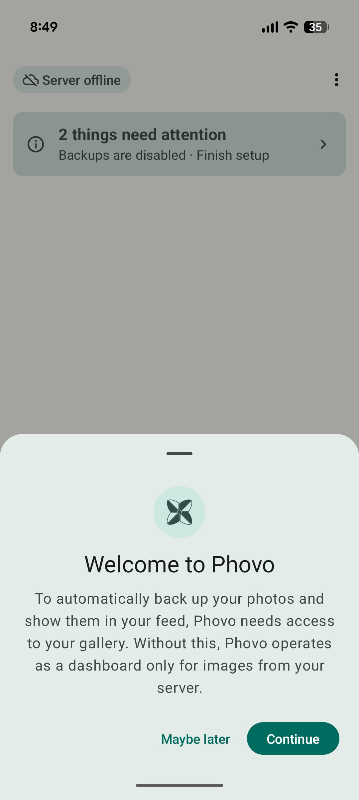
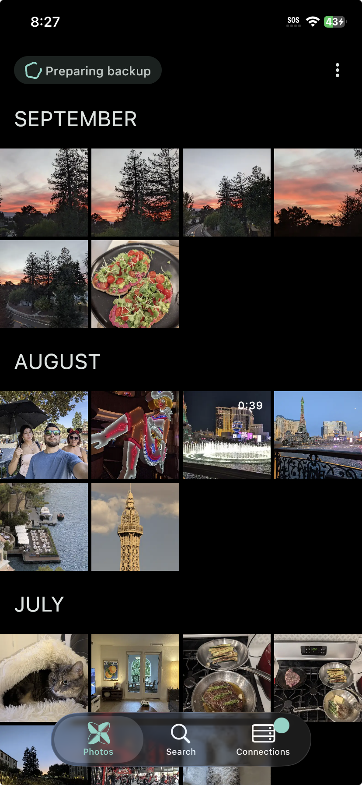
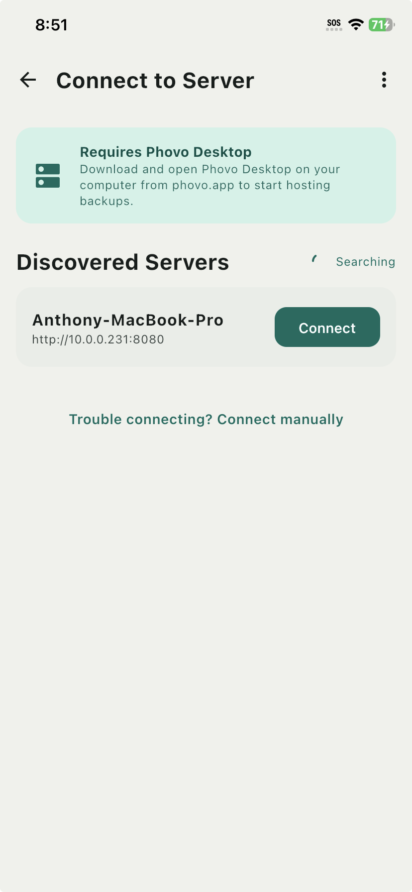
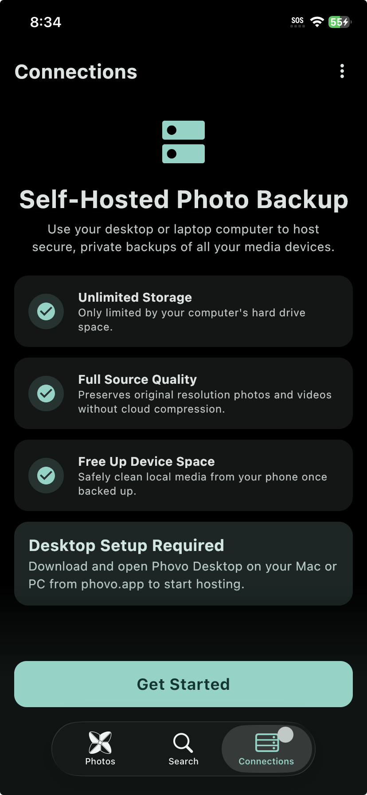
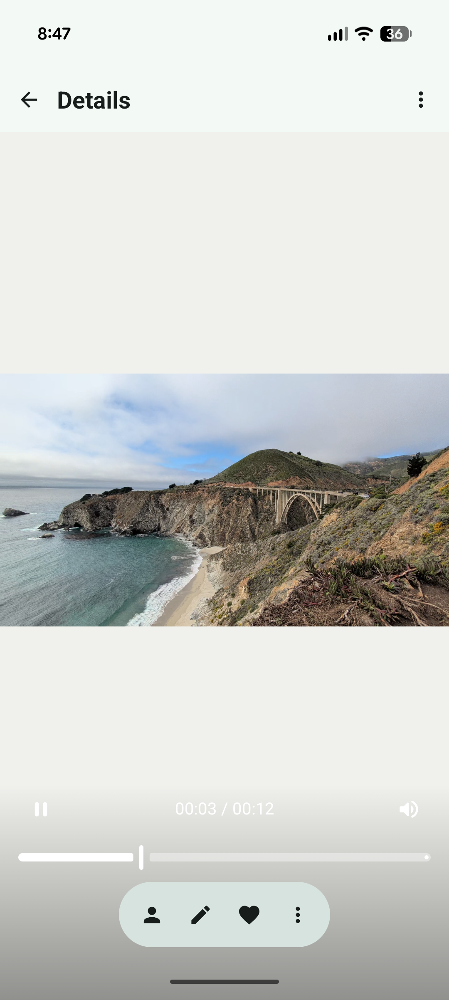

## Self hosted Photo/Video backup
This is a Kotlin Multiplatform project targeting Android, iOS, Desktop and WASM(WEB) clients. Phovo is intended to be a self hosted cloud storage solution that enables seamless access to photos and videos on all compatible target devices. While initially support for 4 clients is planned, if there is strong market demand for this product Wear OS, Android XR, and Android TV may eventually be targeted.

### iOS, Android, Browser and Desktop Applications
All applications are developed within a single codebase using [Kotlin Multiplatform technology](https://kotlinlang.org/docs/multiplatform.html). The UI is implemented using [Compose Multiplatform UI framework](https://www.jetbrains.com/lp/compose-multiplatform/).

### Screenshots
|  |  |  |
| --- | --- | --- |
|  |  |  |

#### Desktop


## 🗓️ Phovo Release Schedule

Phovo is currently undergoing active development. Core logic, architecture, and UI foundations are still being refined. The following is the planned release timeline:

---

### 🚩 October 31, 2026 — Alpha Release
**Availability:** Internal  
**Focus:**  
- Early testing of core features  
- Rapid iteration  
- Expect bugs, instability, and breaking changes without backward compatibility  
- Continued development of initial feature set

---

### 🚩 February 28, 2027 — Beta Release
**Availability:** Public  
**Focus:**  
- Initial feature development complete  
- No further breaking changes  
- Begin stabilization efforts  
- Resolve remaining functional issues

---

### 🏁 May 31, 2027 — Stable Release
**Availability:** Android, iOS & Desktop  
**Focus:**  
- Production-ready release  
- All critical and high-priority bugs resolved  
- Full cross-platform support

## 🌿 Branching and Releases

Releases are published on [GitHub Releases](https://github.com/Anthony17serrato/Phovo/releases). Alphas and
betas are marked as pre-releases, so the "Latest" badge always points at the newest stable build.

### Branches

| Branch | Holds | Releases tagged from it |
|---|---|---|
| `main` | Stable code. It only changes through PRs from `develop`, `release/*` or `hotfix/*`. | Stable: `v1.0.0`, `v1.0.1`, `v1.1.0` |
| `develop` | The default branch. Feature and fix branches merge here. | Alphas, and betas before 1.0 |
| `release/x.y` | A beta line, cut from `develop` when version x.y stops taking new features. Deleted after it ships. | Betas: `v1.1.0-beta.1`, `v1.1.0-beta.2` |
| `hotfix/x.y.z` | A patch for the current stable version, cut from `main`. | The stable patch, e.g. `v1.0.1` |
| `feature/*`, `fix/*`, `docs/*` | Day to day work, merged into `develop` by PR. | None |

Before 1.0 there is nothing older to keep stable, so `develop` carries both the alphas and the betas and
no `release/*` branch exists. Once 1.0 ships, `develop` moves on to the next version and each later beta
gets its own `release/x.y` branch.

```
main        ──●───────────────●──────────●─────────▶  stable: v1.0.0, v1.0.1, v1.1.0 …
              ▲  hotfix/1.0.1 │          ▲
              │       ╲       ▼          │ (1.1 is done)
release/1.1   │        ●──────●────●─────●            beta: v1.1.0-beta.1, beta.2 …
              │       ╱            ╲ merge forward
develop     ──●──────●──────────────●──────────────▶  next features (1.2 alpha)
```

### Patching stable and beta together

A fix goes on the oldest line that has the bug and is then merged forward into every newer line. Each
newer branch picks the fix up through an ordinary merge, which also leaves a record in history of which
lines have it.

1. Cut `hotfix/1.0.1` from `main` and fix the bug there.
2. Merge it into `main` and release `v1.0.1`.
3. Merge `main` into `release/1.1` and release the next beta, e.g. `v1.1.0-beta.3`.
4. Merge `release/1.1` into `develop`.

A bug that only exists in the beta gets its fix on `release/1.1`, which is then merged into `develop`.
Avoid fixing on `develop` and cherry-picking backwards: the copies aren't linked in history, so it's easy
to miss a line.

### Versioning

Versions follow [SemVer](https://semver.org) with a pre-release suffix, and every release is a tag of the
form `v<version>`:

```
v1.0.0-alpha.1 → v1.0.0-alpha.2 → v1.0.0-beta.1 → v1.0.0 → v1.0.1 → v1.1.0-beta.1 → v1.1.0
```

Keep the dot before the pre-release number. SemVer compares `alpha.10` numerically, after `alpha.9`, but
compares `alpha10` as text, which puts it before `alpha9`.

Installers can't use that version directly. macOS and Windows packages only accept plain numbers, Android's
`versionCode` must be an integer, and all of them refuse to install a lower number over a higher one. The
numeric versions are calculated from the SemVer version so they sort the same way across every release
line:

```
versionCode = major × 1,000,000 + minor × 10,000 + patch × 100 + stage
stage:        alpha.N = 10 + N    beta.N = 50 + N    rc.N = 80 + N    stable = 99
```

| Version | Android `versionCode` | Desktop package version |
|---|---|---|
| `1.0.0-alpha.1` | 1000011 | 1.0.11 |
| `1.0.0` | 1000099 | 1.0.99 |
| `1.0.1` | 1000199 | 1.0.199 |
| `1.1.0-beta.2` | 1010052 | 1.1.52 |
| `1.1.0` | 1010099 | 1.1.99 |

A stable patch like `1.0.1` always sorts below a newer beta like `1.1.0-beta.2`, so beta testers are never
offered a stable build as an "upgrade". The desktop version is `major.minor.(patch × 100 + stage)`, which
stays inside Windows Installer's limit of 65535 for the third field. The scheme allows up to 39 alphas, 29
betas and 18 release candidates per version, and up to 99 minor and 99 patch versions.

# Project Structure
## How to build and run
The project can be assembled in an environment which has been configured for Kotlin Multiplatform development, please follow the official guide:
https://kotlinlang.org/docs/multiplatform/quickstart.html#set-up-the-environment

The desktop build embeds an FFmpeg binary, used for thumbnail generation. It is downloaded and
verified against a pinned SHA-256 on the first build, so that build needs network access. The
archive is cached under `~/.gradle/caches/phovo-ffmpeg`, which survives `clean`, so later builds
work offline. Only the binary for the platform running the build is fetched. The pinned builds, and
notes on updating them, live in `build-logic`'s `FfmpegDistribution.kt`.

### Windows: x64 only
Phovo publishes Windows builds for x64 only. Windows on ARM devices run the x64 build through
Windows' built-in x64 emulation, so there is no separate ARM64 release.

The reason is SQLite. Room uses `BundledSQLiteDriver` from `androidx.sqlite:sqlite-bundled`, and its
JVM artifact ships a native library for `windows_x64` but none for `windows_arm64` (checked on 2.6.2
and 2.7.0). A native ARM64 build compiles and launches, but every database call then fails with
`Cannot find a suitable SQLite binary for windows 11 | aarch64`.

#### Building the x64 release on a Windows on ARM machine
The packaged app bundles the JVM that runs Gradle, and the Skiko and FFmpeg binaries are picked by
that JVM's architecture. To get an x64 app on an ARM machine, Gradle has to run on an x64 JVM:

1. Set `JAVA_HOME` to an **x64 JetBrains Runtime 17**. `gradle/gradle-daemon-jvm.properties`
   requires a JetBrains 17 daemon, so with any other JDK Gradle falls back to an ARM64 JetBrains
   Runtime and the result is ARM64 again.
2. Stop any running daemons so an ARM64 daemon is not reused.
3. Force `createRuntimeImage` to run. It does not notice an architecture change when the JDK
   version is the same, and would otherwise keep a stale ARM64 runtime next to an x64 launcher,
   which fails to start.

```
./gradlew --stop
./gradlew :applicationContainers:desktopApp:createRuntimeImage --rerun :applicationContainers:desktopApp:createDistributable --no-configuration-cache
```

The same `--rerun` applies when switching back to an ARM64 JVM on the same checkout, or run `clean`
first.

## Source Sets
The Phovo project makes use of custom source sets to maximize code re-usability when certain features
are supported only by a subset of platforms. To learn more about custom source sets visit:
https://kotlinlang.org/docs/multiplatform/multiplatform-advanced-project-structure.html#declaring-custom-source-sets

## Troubleshooting WASM issues
When adding new dependencies WASM may require a yarn lock upgrade

`./gradlew kotlinUpgradeYarnLock`
